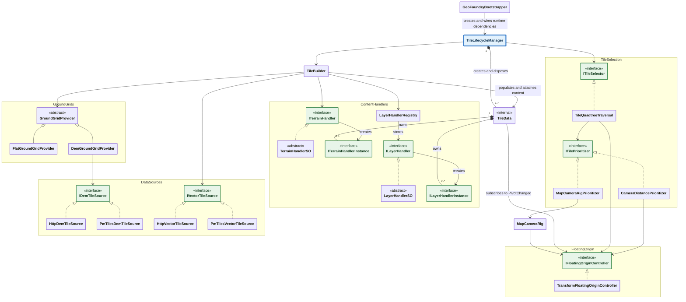

# Runtime architecture

[`TileLifecycleManager`](../Runtime/Tiles/TileLifecycleManager.cs) is the package's core: it creates and
removes tiles, shows and hides their content, and applies the tile memory and concurrent-load budgets.
It delegates tile selection to `ITileSelector`, content construction to `TileBuilder`.

### Selecting and managing tiles

[`ITileSelector`](../Runtime/Core/TileSelection/ITileSelector.cs) decides each frame which tiles should be
rendered, loaded for future display, or retained in memory. It also orders their union by importance.

[`TileQuadtreeTraversal`](../Runtime/Tiles/TileSelection/TileQuadtreeTraversal.cs) is the built-in selector.
It traverses the tile quadtree using the camera frustum, screen-space tile size (the code's SSE metric), and
*coverage*. A tile is *covered* if it is resolved (loaded or failed), skipped by the budget, or all four children
are *covered*. Coverage lets the traversal replace a parent with descendants when its area is covered, even if
intermediate levels were never loaded. Budget-skipped tiles count as covered but leave holes; failed tiles
count as resolved but render no content. See the class's XML documentation for the complete replacement,
loading and coverage rules. The traversal depends on `IFloatingOriginController` and `ITilePrioritizer`.

[`ITilePrioritizer`](../Runtime/Core/TileSelection/ITilePrioritizer.cs) supplies both load priority and importance
for retention or eviction when the budget is exceeded. The two built-in strategies are:

- [`CameraDistancePrioritizer`](../Runtime/Tiles/TileSelection/CameraDistancePrioritizer.cs): importance is the
  distance from the camera to the nearest point of the tile. Visible loads are prioritized by screen-space size.
- [`MapCameraRigPrioritizer`](../Runtime/CameraControl/MapCameraRigPrioritizer.cs): works with `MapCameraRig`.
  In Ground mode, importance and load priority use ground distance from the orbit target (the point the camera
  looks at) to the nearest point of the tile. In Free mode, or while the rig is inactive, it delegates to a fallback
  strategy, normally `CameraDistancePrioritizer`. This implementation is internal and is supplied by the rig.

### Floating origin and camera

[`IFloatingOriginController`](../Runtime/Core/Coordinates/IFloatingOriginController.cs) exposes the current
global pivot and the `PivotChanged` event. Moving this pivot keeps Unity coordinates small to limit floating-point
precision artifacts at large map coordinates. Listeners decide how to handle the notification for their own
objects and systems; the interface does not prescribe a scene-wide transform operation.

[`TransformFloatingOriginController`](../Runtime/Core/Coordinates/TransformFloatingOriginController.cs) is the
built-in implementation. When a target `Transform` exceeds the threshold distance, it moves the pivot to the
target's map position, shifts the target near the new origin, and notifies listeners. The camera transform is
the usual target. Tiles and other listeners handle their own
response to the new pivot.

[`MapCameraRig`](../Runtime/CameraControl/MapCameraRig.cs) is the optional camera controller supplied with the
package. It depends on `IFloatingOriginController` to stay synchronized with rebases.

### Building tile content

[`TileBuilder`](../Runtime/Tiles/TileBuilder.cs) orchestrates data loading, content generation and population of
an already-created tile. It depends on `GroundGridProvider`, `IVectorTileSource`, `ITerrainHandler` and
`LayerHandlerRegistry`. It acquires ground grids and MVT data, then passes them to the terrain and layer handlers.

[`GroundGridProvider`](../Runtime/Ground/GroundGridProvider.cs) is an abstract provider of height and normal
grids for requested tiles. Terrain and layer handlers use these grids to build geometry that follows the ground.
The built-in providers are:

- [`FlatGroundGridProvider`](../Runtime/Ground/FlatGroundGridProvider.cs): produces a flat grid without DEM data;
  use it when elevation is unnecessary.
- [`DemGroundGridProvider`](../Runtime/Ground/DemGroundGridProvider.cs): produces a grid from elevation data and
  depends on `IDemTileSource`.

[`ITerrainHandler`](../Runtime/Core/Handlers/ITerrainHandler.cs) generates a terrain instance for each tile.
[`ILayerHandler`](../Runtime/Core/Handlers/ILayerHandler.cs) generates the content of one named MVT layer for
each tile containing that layer. Both are extension points for custom geometry, rendering and layer semantics.
Their abstract [`TerrainHandlerSO`](../Runtime/Core/Handlers/TerrainHandlerSO.cs) and
[`LayerHandlerSO`](../Runtime/Core/Handlers/LayerHandlerSO.cs) bases implement the corresponding interfaces as
ScriptableObjects, so concrete handlers can be configured as assets in the Inspector.

[`LayerHandlerRegistry`](../Runtime/Core/Handlers/LayerHandlerRegistry.cs) stores the registered `ILayerHandler`
instances by MVT layer name. Multiple handlers can process the same layer; they are called in registration order.

### Tile ownership and handler instances

[`TileData`](../Runtime/Tiles/TileData.cs) is the internal owner of one tile's resources: its root GameObject,
ground grid handles, terrain instance and layer instances. `TileLifecycleManager` creates and disposes it and
controls its active state. `TileBuilder` populates it, attaching the content returned by handlers and transferring
the acquired ground grid handles to it. The tile's `MemoryUsage` sums the attached instances' memory; shared
ground grids are accounted for separately.

`TileData` positions its root and subscribes to `IFloatingOriginController.PivotChanged` in its constructor,
before asynchronous content building starts. On a rebase, it recomputes the root position and calls
`OnOriginShifted` on attached instances.

[`ITerrainHandlerInstance`](../Runtime/Core/Handlers/ITerrainHandler.cs) and
[`ILayerHandlerInstance`](../Runtime/Core/Handlers/ILayerHandler.cs) represent the content produced for one tile
by `ITerrainHandler.OnTerrainLoadedAsync` and `ILayerHandler.OnLayerLoadedAsync`, respectively.

### Data sources

[`IDemTileSource`](../Runtime/Core/Sources/IDemTileSource.cs) provides DEM elevation data;
[`IVectorTileSource`](../Runtime/Core/Sources/IVectorTileSource.cs) provides MVT vector data. Each has two
built-in implementations:

| Data | Remote server | PMTiles archive in StreamingAssets |
|---|---|---|
| DEM | [`HttpDemTileSource`](../Runtime/TileIO/Sources/HttpDemTileSource.cs) | [`PmTilesDemTileSource`](../Runtime/TileIO/Sources/PmTilesDemTileSource.cs) |
| MVT | [`HttpVectorTileSource`](../Runtime/TileIO/Sources/HttpVectorTileSource.cs) | [`PmTilesVectorTileSource`](../Runtime/TileIO/Sources/PmTilesVectorTileSource.cs) |

Implement either source interface to support application-specific transport, storage or authentication, such as
an authenticated remote tile service. See [local-pmtiles.md](local-pmtiles.md) for archive setup and platform details.

### Wiring the runtime

[`GeoFoundryBootstrapper`](../Runtime/Bootstrap/GeoFoundryBootstrapper.cs) is a `MonoBehaviour` that creates and
connects the runtime dependencies from `GeoFoundryConfig`, registers the configured handlers, starts the manager
and floating-origin controller, and binds the optional camera controller. It also owns runtime shutdown.
The diagram's single setup arrow represents this wiring; the bootstrapper assembles the entire dependency graph.

Use it for the built-in source modes. For different composition needs, write a custom bootstrapper, fork and
adapt `GeoFoundryBootstrapper`, or wire the dependencies with a DI container. **The unmodified
`GeoFoundryBootstrapper` only creates the built-in HTTP and PMTiles implementations of `IDemTileSource` and
`IVectorTileSource`; custom source implementations require adapting or replacing that wiring.**
